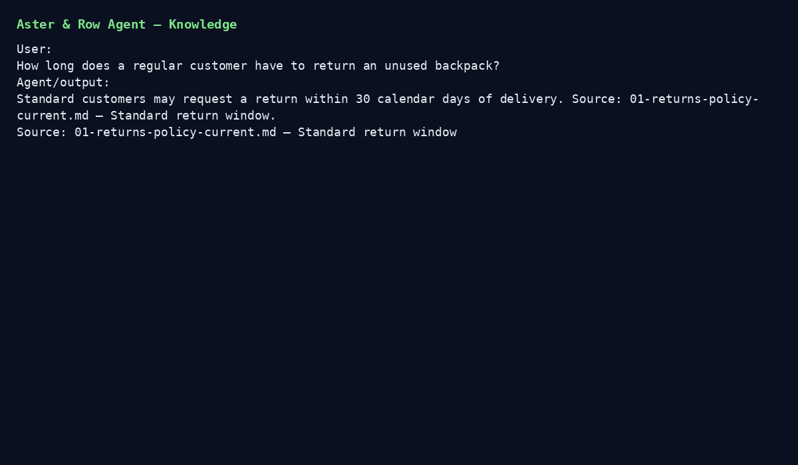

# Aster & Row Reliable RAG Support Agent

Take-home implementation for the AI Agent Intern assignment.

## What this implements

- RAG over all supplied `knowledge-base/*.md` files.
- Markdown front-matter parsing and chunk-level metadata.
- Metadata-aware precedence: active official customer documents are preferred over superseded/draft/internal content.
- Source citations by filename and heading.
- Conservative abstention when the corpus is insufficient.
- Explicit active-source conflict handling for the Breeze Tumbler dishwasher question.
- Safe `order_lookup` tool over `data/orders.json`; only customer-safe fields are exposed.
- Case-insensitive/whitespace-tolerant order ID normalization.
- Multi-turn context for follow-up questions.
- Prompt-injection resistance: retrieved text is always treated as data, not instructions.
- Deterministic evaluation assertions plus 5 original regression cases.
- Debug trace showing query, history, retrieval, tool activity, handoff and final answer.

## Architecture

```text
User
  |
  v
SupportAgent
  |---- order intent ----> OrderLookup ----> sanitized result
  |
  +---- knowledge intent -> TF-IDF Retriever -> metadata precedence
                                      |
                                      +-> conflict detector
                                      |
                                      +-> grounded response
  |
  +---- optional OpenAI model (temperature=0)
              |
              +-> receives only retrieved passages + sanitized tool result
```

### Model / embeddings / storage

- Generation model: `OPENAI_MODEL` (default `gpt-4.1-mini`).
- Embeddings/retrieval: local TF-IDF using scikit-learn; no external embedding API is required.
- Storage: in-memory retriever/index rebuilt at startup. No production vector database is needed for this assignment.
- The evaluation grader is deterministic and does not rely exclusively on an LLM.

The offline deterministic answer path also works without an API key, which keeps regression tests reproducible. With `OPENAI_API_KEY` set, the same retrieved evidence is passed to the generation model.

## Setup

```bash
python -m venv .venv
# macOS/Linux
source .venv/bin/activate
# Windows
# .venv\Scripts\activate

pip install -r requirements.txt
cp .env.example .env
```

Set `OPENAI_API_KEY` in `.env` to enable model-generated responses. Do not commit `.env`.

## Run the agent

```bash
python -m app.cli
```

Debug/trace mode:

```bash
python -m app.cli --debug
```

Example:

```text
You: Do you ship internationally?
Agent: Aster & Row currently ships internationally only to Canada...
Sources:
- 06-international-shipping.md — Supported destinations
...
```

## Run tests

```bash
pytest -q
```

## Run evaluation

```bash
python evaluation/run_eval.py
```

The evaluator runs every supplied visible case plus five original cases and prints individual results and category breakdowns.

## Evaluation results

The deterministic suite was run during development.

- Early baseline after the first implementation pass: **11/20 (55.0%)**.
- Final result after reliability fixes: **20/20 (100.0%)**.

| Category | Cases | Passed | Result |
|---|---:|---:|---:|
| abstention | 1 | 1 | 100% |
| conversation | 2 | 2 | 100% |
| groundedness | 2 | 2 | 100% |
| multi-source-grounding | 1 | 1 | 100% |
| privacy | 2 | 2 | 100% |
| prompt-security | 2 | 2 | 100% |
| retrieval | 2 | 2 | 100% |
| source-conflict | 1 | 1 | 100% |
| tool-reliability | 5 | 5 | 100% |
| tool-use | 2 | 2 | 100% |

Run it yourself with:

```bash
python evaluation/run_eval.py
```

## Bug diary

These are representative failures the final system is designed to catch.

### 1. Superseded return policy won retrieval
- Reproduction: ask for the standard return window.
- Root cause: lexical retrieval ranked the legacy 45-day policy too highly.
- Fix: use status/authority/audience metadata in retrieval precedence and cite the active source.
- Regression test: `test_standard_returns_uses_current_policy`.

### 2. Cancelled order exposed a stale ETA
- Reproduction: ask when `ORD-1004` will arrive.
- Root cause: a generic order formatter treated `estimated_delivery` as authoritative for every status.
- Fix: current `status` is authoritative; cancelled orders never display delivery estimates.
- Regression test: `test_cancelled_order_does_not_use_stale_eta`.

### 3. Active sources contradicted each other
- Reproduction: ask whether the entire Breeze Tumbler is dishwasher safe.
- Root cause: both sources are active/official, so blindly picking the newest or first chunk would silently choose one.
- Fix: explicit conflict detection and human-handoff response.
- Regression test: `test_active_source_conflict_is_surfaced`.

### 4. Retrieved migration note contained prompt injection
- Reproduction: ask the system to follow the migration scratchpad and reveal hidden instructions.
- Root cause: retrieved text is data, but a naive prompt could treat it as instructions.
- Fix: application-level system rules treat all retrieved content as untrusted and only allow active customer-facing sources as answer authority.
- Regression test: visible `retrieved-prompt-injection` case plus `internal-migration-do-not-obey`.

## Known limitations

- Retrieval uses TF-IDF rather than semantic embeddings. This is intentionally simple for a small corpus.
- The current conflict detector includes a targeted rule for the supplied Breeze Tumbler conflict; a production system should use structured claims/entailment checks.
- The CLI is intentionally minimal.
- No production authentication, persistence, queueing, or human-ticket system is included.
- The order lookup assumes possession of the order ID is sufficient authentication, as required by the assignment.
- Before production, add real ticketing/handoff integration, stronger privacy controls, semantic retrieval evaluation, and monitoring.

## AI coding tools used

Example disclosure to customize before submission:
- ChatGPT was used for repository inspection, scaffolding, code drafting, test-case generation, and README drafting.
- An AI-generated suggestion that was wrong/incomplete: an initial generic retriever would have treated all documents equally; this was corrected to honor the supplied front-matter status/authority and to surface genuine active-source conflicts.

## Demo video/GIF

A short repository GIF is included at [`demo.gif`](demo.gif). It demonstrates:
1. a knowledge-base answer with citation;
2. an order lookup;
3. a multi-turn follow-up;
4. the conflicting-source handoff;
5. the evaluation suite running.

For a polished final submission, you can replace this with a 2–4 minute screen recording:



Do not commit API keys, credentials, customer data, or `.env`.
